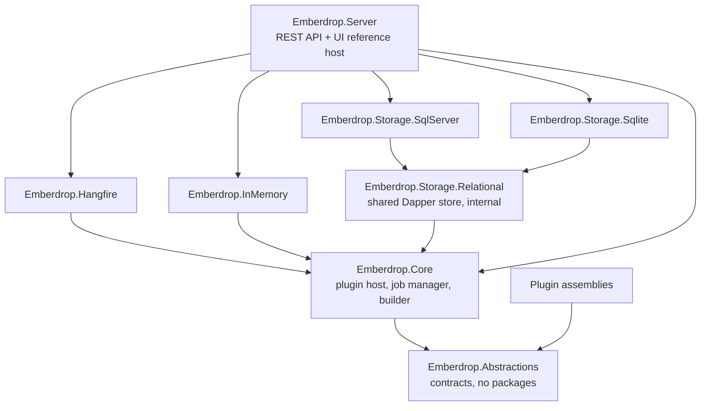

# Design: provider-agnostic Emberdrop

> **Historical document.** This is the original design proposal, written before the work began, and it is kept as a record of the starting point. It has been implemented and in places superseded: "Current state" (section 1) and the defects (section 2) describe code that no longer exists, and it says "job" where the project now says "work unit" ([ADR 0008](../adr/0008-work-units-not-jobs.md)). For how things work today, read [Architecture](../architecture.md) and the [decision records](../adr/).

Status when written: proposal, awaiting review (Slice 0), with no code changed.

Emberdrop is a library for hot-loading versioned job assemblies into a running .NET host. Today it is welded to Hangfire and SQL Server. This document records what the code does now (section 1), where the defects are (section 2), and the target design (section 3 onward).

Confidence labels used below: **[read]** established by reading the code, **[verify]** a claim about third-party or runtime behavior that the relevant slice must confirm with a test before relying on it.

---

## 1. Current state

### 1.1 Solution layout

| Project | Contents |
|---|---|
| `Emberdrop.Core` | One file: `IEmberdropJob { Task Start(int id); }`. No dependencies. |
| `Emberdrop.Server` | Everything else: ASP.NET host, `JobsController`, `JobManagement/*`, `Plugins/*`, FluentMigrator migration, Dapper repository, Hangfire wiring, two sample jobs. |
| `tests/Emberdrop.Server.Tests` | 43 xUnit tests. |
| `SamplePlugin` | Two jobs; an MSBuild target zips the build output into `watched-plugins/*.emberdrop`. |

`Core` is effectively empty. The real library is trapped inside a web application project, so nothing can be consumed as a package today.

### 1.2 Where Hangfire and SQL Server leak

| Location | Leak |
|---|---|
| `Server.csproj` | Direct refs: `Hangfire`, `Hangfire.SqlServer`, `Microsoft.Data.SqlClient`, **and** the legacy `System.Data.SqlClient` (redundant), `FluentMigrator.Runner` with SQL Server dialect, Dapper. |
| `Program.cs` | `AddHangfire(UseSqlServerStorage(...))`, `AddHangfireServer()`, `UseHangfireDashboard()`, `AddSqlServer()` migration runner, inline startup orchestration (migrate, init jobs, start watcher). |
| `JobManagement/JobSchedulerService.cs` | Uses `IRecurringJobManager` directly and Hangfire's expression API `AddOrUpdate(id, () => jobInstance.Start(id), cron)`. |
| `JobManagement/JobManagerServiceExtensions.cs` | Registers `IRecurringJobManager`. |
| `JobManagement/JobScheduleConstants.cs` | `NEVER_SCHEDULE = "0 0 31 2 *"` is a Hangfire workaround (a cron that never fires) living in the domain layer. |
| `JobManagement/JobRepository.cs` | `SqlConnection` (Microsoft.Data.SqlClient), T-SQL (`SCOPE_IDENTITY()`, `[bracket]` quoting), reads `GetConnectionString("DefaultConnection")` on every call. |
| `Migrations/CreateSystemJobTable.cs` | One FluentMigrator migration; `ScanIn(typeof(Program).Assembly)` couples it to the host. |
| `JobManagement/SystemJob.cs` | Persistence model doubles as the domain model and is exposed through `IJobRepository`. |
| `Jobs/EmailNotificationJob.cs` | Comment: "Hangfire will handle retries". |
| `appsettings.json` | `Serilog.Override.Hangfire`, SQL Server connection string. |
| Client | `jobs.component.*`: "View in Hangfire" button opens `/hangfire`. |
| `docker-compose.yml` | `azure-sql-edge` image (deprecated), SQL Server is the only database offered. |
| Docs | `README.md`, `tests/.../README.md`, `docs/database-schema.md` describe Hangfire/MSSQL as the architecture. |

Leaks into `Core`: none (it contains one interface). The problem is the opposite: nothing is in `Core`, so every abstraction has to be created, not extracted.

### 1.3 Plugin loading, as implemented

Flow **[read]**: `FileSystemWatcher(*.emberdrop)` on each configured path -> `ProcessPluginFileAsync` -> fixed `Task.Delay(1000)` -> `ZipFile.ExtractToDirectory` to `<watched>/temp/<name>_<guid8>` -> "scan" -> read version -> compare with `PluginAssemblyCache` -> copy to `<host bin dir>/plugins/<name>-<version>/` -> `Assembly.LoadFrom` for each DLL -> `RegisterJobAsync` per job type.

Loading: **everything is `Assembly.LoadFrom` into the default `AssemblyLoadContext`** (`PluginAssemblyCache.LoadAssemblyFromPath`). `JobDiscoveryService` additionally does `Assembly.Load(byte[])` for every `*.dll` under the plugins directory.

"Unload": `UnloadPluginVersionAsync` removes dictionary entries. It does not, and cannot, unload anything.

Quarantine: `MoveToInvalidDirectory` moves the `.emberdrop` file to `plugins/invalid/` and logs the reason. Nothing else.

### 1.4 Plugin-hosting defects

Severity: **Blocker** = the headline feature does not work as documented; **High** = data loss / wrong behavior in realistic use; **Medium** = fragility; **Low** = hygiene.

| # | Sev | Defect | Evidence |
|---|---|---|---|
| P1 | Blocker | **Assemblies can never be unloaded.** Default ALC is not collectible. The docs' "unload", "proper unloading" and "memory management" claims are false: `UnloadPluginVersionAsync` only forgets the `Assembly` reference. | `PluginAssemblyCache.cs:322-335`, `:210-232` |
| P2 | Blocker | **Hot update does not run new code.** `LoadFrom` of a second file with the same assembly identity returns the already-loaded assembly. A same-version redeploy therefore keeps executing the old code. A different-version redeploy loads a second assembly with the same simple name into the default ALC, which .NET (Core) rejects. [verify in Slice 5; this is the expected runtime behavior] | `PluginService.cs:144-161` |
| P3 | Blocker | **No side-by-side versions.** `_pluginVersions` is keyed by plugin name only, so one version is tracked per plugin. On restart, `InitializeExistingPluginsAsync` registers every `name-version` folder under the same key and the last folder enumerated wins, in filesystem order. | `PluginAssemblyCache.cs:190-208`, `PluginService.cs:633-682` |
| P4 | Blocker | **Resolver caches `Type` forever.** `JobTypeResolver._typeCache` is a `ConcurrentDictionary<string, Type>` that is never invalidated. After an update the old `Type` is still returned, and it would pin an old context even if one existed. | `JobTypeResolver.cs:13`, `:30` |
| P5 | High | **"Validation" validates nothing.** `ScanExtractedPluginAsync` adds `typeof(object)` as a placeholder for every DLL whose name doesn't start with `Emberdrop.Core`/`Microsoft.`/`System.`. `ContainsEmberdropJobsSimplified` returns `true` for the same set. So the "no IEmberdropJob implementations found" quarantine path is reachable only for an archive with no such DLL. A package containing only `Newtonsoft.Json.dll` is accepted. | `PluginService.cs:465-508`, `:770-796` |
| P6 | High | **Wrong version is recorded.** Version = first non-system DLL in `Directory.GetFiles(..., AllDirectories)` order, which is any bundled dependency (e.g. `Dapper.dll` -> `2.1.0.0`). Plugin name is the file name, not anything in the package. | `PluginService.cs:720-753` |
| P7 | High | **Update path duplicates job rows.** `ProcessNewPluginAsync` always calls `RegisterJobAsync`, which always inserts a new `SystemJob` row and schedules it enabled on the default hourly cron. Every reload or update adds duplicates that all run. | `PluginService.cs:407-423`, `JobRegistrationService.cs:81-111` |
| P8 | High | **No tracking of in-flight jobs.** Nothing knows what is running, so there is no drain, no wait, no cancellation. Same-version replacement deletes the plugin directory while its assemblies are mapped (hard failure on Windows, undefined behavior elsewhere). | `PluginService.cs:295-321` |
| P9 | High | **Concurrent processing of one file.** Created, Changed and Renamed handlers are `async void` and all call `ProcessPluginFileAsync`. A normal copy raises several events, so the same package is processed concurrently; the loser sees a deleted file and the failure path moves it to `invalid/`. The only "write finished" check is `Task.Delay(1000)`, which is wrong for large files and network shares. | `PluginService.cs:510-547`, `:106` |
| P10 | High | **Failure after commit leaves half-installed plugins.** `MoveToPluginsDirectory` deletes the source `.emberdrop` early. Any later exception then tries to quarantine a file that no longer exists (logged, swallowed) while the plugin directory stays installed and registered in the cache. | `PluginService.cs:554-592`, `:172-176` |
| P11 | High | **Load failures are swallowed.** Assembly load errors are logged at Warning/Debug, the plugin is reported "successfully processed" with 0 job types, and it is not quarantined. A plugin whose entry assembly throws on load leaves the system in a silently inconsistent state. | `PluginService.cs:401-405`, `PluginAssemblyCache.cs:118-121` |
| P12 | High | **Archived versions are re-scanned.** `JobDiscoveryService` scans `plugins/**/*.dll`, which includes `plugins/archive/**` (old extracted versions). Old job types are discovered as if current. (`invalid/` holds only `.zip`s so quarantined code is *not* loaded; no issue there.) | `JobDiscoveryService.cs:105-130` |
| P13 | Medium | **Dependency conflicts are unresolvable.** All plugin dependencies share one namespace (the default context) with the host and each other. A plugin needing a different `Newtonsoft.Json` than the host or another plugin either silently gets the first-loaded copy or fails. There is no `AssemblyDependencyResolver`, no `.deps.json` use, no native-library resolution. | whole loading path |
| P14 | Medium | **Contract assembly identity is accidental.** `SamplePlugin` zips its whole output, including a copy of `Emberdrop.Core.dll`. It works only because the file-name prefix filter skips that copy and the runtime already has the host's. There is no rule, no version check. | `SamplePlugin.csproj`, `PluginService.cs:386` |
| P15 | Medium | **Stray-DLL loading.** `JobTypeResolver.ScanAndLoadPluginAssemblies` `LoadFrom`s every DLL in every plugin folder (including `System.*`, `Microsoft.*`) to look for a type, uses `.Result` (sync-over-async), and `catch`es everything at Debug level. | `JobTypeResolver.cs:118-176` |
| P16 | Medium | **Persisted plugin state is inferred from folder names.** `name-version` is parsed back with `Split('-')`, so a pre-release version (`1.0.0-beta`) or the `_1` collision suffix corrupts the name/version. | `PluginService.cs:650-653`, `:561-567` |
| P17 | Medium | **Plugins directory is under the host's binaries** (`Assembly.Location/plugins`), hard-coded in three classes, not configurable. Breaks read-only containers and means plugin state is lost on redeploy of the host. | `PluginService.cs:34`, `JobTypeResolver.cs:25`, `JobDiscoveryService.cs:17` |
| P18 | Medium | **Zip handling has no limits.** `ExtractToDirectory` guards against path traversal, but there is no cap on entry count or uncompressed size (zip bomb), and no integrity option. | `PluginService.cs:450-453` |
| P19 | Low | **Quarantine is write-only.** The reason is a log line. It is not stored next to the file, not queryable, not shown in the API/UI, and a quarantined package is retried if it is dropped again unchanged. | `PluginService.cs:602-628` |

### 1.5 Other defects found while reading (not plugin loading)

| # | Sev | Defect |
|---|---|---|
| S1 | High | **Hangfire job type for plugin jobs.** `() => jobInstance.Start(job.JobId)` makes Hangfire serialize the *runtime type* of `jobInstance` as an assembly-qualified name, to be re-resolved with `Type.GetType` in the default context when the job fires **[verify in Slice 2]**. That works only because plugins are in the default ALC, i.e. it works *because of* the unloadable design. With collectible contexts it cannot work, and persisted recurring jobs would also reference stale plugin assembly versions after every update. Also, `ScheduleJob` constructs a real job instance through DI only to read its type, then discards it. The adapter must schedule a stable host-side trampoline, never a plugin type (section 4.3). |
| S2 | High | `GenerateJobGuid` truncates `"{name}-{guid}"` to 30 chars. For names of 30+ characters the GUID is cut off entirely, so two jobs with the same long prefix get the same `Identifier`. |
| S3 | High | `JobsController.UpdateJob` writes the row but never reschedules; `DeleteJob` deletes the row but never removes the recurring job. Schedule/enable changes take effect only after restart, and deleted jobs keep firing (then fail to resolve). `CreateJobRequest.Identifier` is `[Required]` but ignored. There is no endpoint for "run now" even though `RunJobAsync` exists. |
| S4 | Medium | `RegisterDiscoveredJobsAsync` matches existing rows by simple class name, so two plugins with a same-named class collide. It also looks up the freshly created job in a stale `existingJobs` snapshot, so new jobs are never scheduled in the same pass. |
| S5 | Medium | `RunJobAsync` ("trigger now") runs the job inline on the caller's thread, bypassing the scheduler (no history, no retries). |
| S6 | Medium | Job contract `Start(int id)`: no `CancellationToken`, no run context, and the argument is the database primary key, leaking a storage detail into the plugin API. Metadata is only reachable if the plugin queries the database itself. Cooperative cancellation is a prerequisite for drain-then-unload. |
| S7 | Medium | Mixed `DateTime.Now` (repository) and `DateTime.UtcNow` (controller); the migration default is the server's local time. |
| S8 | Medium | Docs say `EmberdropConnection`, code reads `DefaultConnection`. The quick start never creates the `Emberdrop` database, which Hangfire's schema bootstrap needs to exist already. |
| S9 | Medium | `Program.cs` catches every startup exception, logs `Fatal`, and exits 0. `MissingMigrationsException` is silently swallowed. `UseAuthorization()` without `AddAuthorization()`. |
| S10 | Low | Several tests assert on POCO properties they just set (`JobSchedulerServiceShould.AcceptValidSystemJob`); the scheduler and plugin loader have no behavioral tests. `PluginServiceShould` mocks the cache, so none of the loading code is exercised. |
| S11 | Low | `docs/RENAME.md` is linked from the README and does not exist. `System.Data.SqlClient` and `Microsoft.Data.SqlClient` both referenced. Default Grafana password in compose. Loki sink enabled in the shipped `appsettings.json`. |
| S12 | Low | The Hangfire dashboard (`UseHangfireDashboard()` with defaults) allows local requests only; fine for dev, a 403 in any deployed environment. |

### 1.6 Environment note

The machine has only the .NET 10 runtime/SDK; every project targets `net9.0`, so plain `dotnet test` aborts ("framework 9.0.0 not found"). Baseline run: `DOTNET_ROLL_FORWARD=Major dotnet test emberdrop.sln` -> 43 passed, 0 failed. CI installs 9.0.x, so CI is unaffected. See section 9 (target frameworks).

---

## 2. Goals and non-goals

Goals: engine-agnostic scheduling, store-agnostic persistence, and a plugin host whose safety claims are true and tested.

Non-goals (explicitly not built): package signing, plugin sandboxing or permission restriction, authentication for the REST API, distributed coordination across hosts beyond what an engine already provides, plugin-registered DI services, a plugin marketplace.

**Isolation is not security.** A collectible `AssemblyLoadContext` gives dependency isolation and unloadability. It does not restrict what plugin code can do; .NET has no in-process sandbox. Plugins are fully trusted code. This is stated in the README Security section and in the plugin guide.

---

## 3. Target architecture

### 3.1 Projects



| Project | Responsibility | Package dependencies |
|---|---|---|
| **Emberdrop.Abstractions** | Everything a *plugin author* or *provider author* compiles against. `IEmberdropJob`, `[EmberdropJob]` attribute, `JobContext`, `IJobScheduler` + capability model + request/result records, `IJobStore` + `JobDefinition`, `IPluginHost` + `PluginDescriptor`/`PluginState`, options records. BCL types only. | **None.** |
| **Emberdrop.Core** | Package reader/validator, `PluginLoadContext`, `PluginHost`, drain/unload, quarantine, folder watcher, `JobManager` (application service), job runner/trampoline, reconciliation of discovered jobs with the store, `IEmberdropBuilder` + `AddEmberdrop`, hosted service for startup. Built on Abstractions only. | `Microsoft.Extensions.{DependencyInjection,Logging,Options,Hosting}.Abstractions`, `System.Reflection.MetadataLoadContext` |
| **Emberdrop.Hangfire** | `HangfireJobScheduler : IJobScheduler`, `UseHangfire(...)`, the stable trampoline job, optional dashboard mapping. | `Hangfire.Core`, `Hangfire.NetCore`; `FrameworkReference Microsoft.AspNetCore.App` only for the dashboard extension. **Not** `Hangfire.SqlServer`: the caller picks Hangfire's own storage. |
| **Emberdrop.InMemory** | Timer-based scheduler (cron, one-off, delayed) and in-memory store. For demos, tests, the SQLite quick start. | `Cronos` (same cron parser Hangfire uses, so cron semantics match) |
| **Emberdrop.Storage.Relational** | Shared Dapper-based `JobStore` with a small `ISqlDialect` (identity retrieval, quoting, paging, `UtcNow`). Not a public extension point; ships inside the two storage packages' dependency graph. | `Dapper`, `FluentMigrator.Runner.Core` |
| **Emberdrop.Storage.SqlServer** / **.Sqlite** | `UseSqlServer(cs)` / `UseSqlite(cs)`, dialect, **per-provider migrations**. | `Microsoft.Data.SqlClient` / `Microsoft.Data.Sqlite`, FluentMigrator dialect runner |
| **Emberdrop.Server** | Reference host: controllers, DTOs, Serilog, composition root via `AddEmberdrop`. Not a package. | Serilog, ASP.NET Core |

Adjustments to the suggested split:

1. **`Emberdrop.Storage.Relational` added.** Without it the two storage providers duplicate all Dapper and mapping code and drift apart.
2. **`IEmberdropBuilder` lives in Core, not Abstractions**, to keep Abstractions free of any package (it is the one assembly that is shared between host and plugins; section 5.3). The cost: provider packages reference Core for the builder extension point. Hangfire.* packages follow the same pattern (they reference Hangfire.Core).
3. **`IPluginHost` contract is in Abstractions, implementation in Core.** Hosts that only want to *query* plugin state (e.g., a UI) don't need Core.
4. **Plugin state is not stored in the database.** Installed versions, active version, and quarantine reasons live on disk next to the packages (section 5.6), so `IJobStore` stays "job definitions only" and there is one fewer migration to maintain per provider.

Two different stores, which the docs must keep apart:

- **Engine storage** is the scheduler's own state (Hangfire's tables/in-memory store, or nothing for the InMemory scheduler). The engine owns it.
- **Emberdrop store (`IJobStore`)** is the catalog: job definitions, schedules, enabled flag, metadata, which plugin a job belongs to. Emberdrop owns it.

Hangfire + SQL Server therefore means two SQL Server schemas, as today; Hangfire + SQLite store means Hangfire with its own storage plus the SQLite catalog.

### 3.2 Namespaces

Root namespace `Emberdrop` for contracts (`Emberdrop.IEmberdropJob`), `Emberdrop.Scheduling`, `Emberdrop.Storage`, `Emberdrop.Plugins`. See question Q2 about compatibility with already-built packages.

### 3.3 Fluent registration

```csharp
services.AddEmberdrop(b => b
    .UseHangfire(h => h.UseInMemoryStorage())        // or .UseInMemoryScheduler()
    .UseSqlite("Data Source=emberdrop.db")           // or .UseSqlServer(cs) / .UseInMemoryStore()
    .WatchFolder("./plugins")                        // may be called more than once
    .ConfigurePlugins(o =>
    {
        o.DrainTimeout = TimeSpan.FromMinutes(2);
        o.StorageRoot  = "./.emberdrop";             // installed/, staging/, quarantine/
        o.AllowedPackageHashes.Clear();              // empty = integrity check off (default)
    }));

app.MapEmberdropHangfireDashboard("/hangfire");      // adapter-specific, optional
```

Rules:

- Exactly one scheduler and one store must be configured. `AddEmberdrop` registers an options validator that fails at host start (`ValidateOnStart`) with a message naming the missing piece and the available `Use*` methods. No silent defaults.
- Everything that today lives imperatively in `Program.cs` (migrate, reconcile jobs, start watcher) moves into one `IHostedService` in Core. The host's `Program.cs` becomes composition only.
- Connection strings and options are bound from configuration section `Emberdrop` when `AddEmberdrop(IConfiguration)` is used, with the fluent calls taking precedence.

---

## 4. Contracts

All signatures are sketches; XML docs, `CancellationToken`s on every async method, and `sealed` records are assumed.

### 4.1 Job contract (plugin-facing)

```csharp
[AttributeUsage(AttributeTargets.Class)]
public sealed class EmberdropJobAttribute : Attribute
{
    public string? Id { get; init; }            // stable job id; default: full type name
    public string? DisplayName { get; init; }
    public string? Description { get; init; }
    public string? DefaultSchedule { get; init; }   // cron, optional
}

public interface IEmberdropJob
{
    Task ExecuteAsync(JobContext context, CancellationToken cancellationToken);
}

public sealed record JobContext(
    int JobId, string JobKey, string? Metadata, string PluginId, string PluginVersion, int Attempt);
```

This replaces `Start(int id)`. Reason: without a cancellation token a job cannot be drained or stopped (S6). `Metadata` is delivered rather than fetched through the database. Whether to break `Start(int)` or support both is Q2.

Job identity changes from "simple class name" (S4) to **`JobKey = "{pluginId}:{jobId or full type name}"`**, unique across plugins. Host-resident jobs use `pluginId = "host"`.

### 4.2 Scheduler contract

```csharp
public interface IJobScheduler
{
    SchedulerCapabilities Capabilities { get; }

    Task UpsertRecurringAsync(RecurringJobSpec spec, CancellationToken ct);   // idempotent by ScheduleKey
    Task RemoveRecurringAsync(string scheduleKey, CancellationToken ct);
    Task<JobRunId> EnqueueAsync(JobInvocation invocation, CancellationToken ct);
    Task<JobRunId> ScheduleAsync(JobInvocation invocation, DateTimeOffset runAt, CancellationToken ct);
    Task<JobRunId> TriggerAsync(string scheduleKey, CancellationToken ct);    // "run now" for a recurring job
    Task<CancelResult> CancelAsync(JobRunId runId, CancellationToken ct);
    Task<JobRunInfo?> GetRunAsync(JobRunId runId, CancellationToken ct);
    Task<Page<JobRunInfo>> GetHistoryAsync(JobHistoryQuery query, CancellationToken ct);
}

public sealed record JobInvocation(string JobKey, int JobId, string? Metadata);   // strings/ints only
public sealed record RecurringJobSpec(string ScheduleKey, string Cron, JobInvocation Invocation, TimeZoneInfo? TimeZone);
```

**The engine never sees a plugin type.** The adapter stores `JobInvocation` (plain data) and, when a run fires, calls the engine-agnostic `IJobInvoker` provided by Core:

```csharp
public interface IJobInvoker   // Core -> implemented once, called by every adapter
{
    Task InvokeAsync(JobInvocation invocation, JobRunContext run, CancellationToken ct);
}
```

`IJobInvoker` resolves the *active* plugin version for `JobKey` at fire time, takes a lease on its load context, creates the job, runs it, releases the lease (section 5.4). Consequences: persisted engine state contains only host types and strings; plugin updates never invalidate scheduled work; "disable" and "remove" are plain scheduler operations (no `NEVER_SCHEDULE` hack: disabling removes the recurring entry).

#### Capability model

```csharp
[Flags]
public enum SchedulerFeatures
{
    None            = 0,
    Recurring       = 1 << 0,   // cron
    SecondsCron     = 1 << 1,   // 6-field cron
    TimeZones       = 1 << 2,
    Delayed         = 1 << 3,   // ScheduleAsync
    CancelQueued    = 1 << 4,   // cancel a run that has not started
    CancelRunning   = 1 << 5,   // cooperative cancel of a started run
    History         = 1 << 6,   // GetHistoryAsync returns data
    Retries         = 1 << 7,   // engine retries failed runs
    Durable         = 1 << 8,   // schedules survive host restart
    MultiNode       = 1 << 9,   // safe with several hosts on one engine store
}

public sealed record SchedulerCapabilities(SchedulerFeatures Features, int MinimumRecurringIntervalSeconds, string EngineName);
```

Rules:

1. **Capabilities are declared, not discovered by failure.** Core checks them before calling and turns an unsupported request into a typed `Unsupported(feature)` outcome that REST maps to `422` with the feature name, and that the UI uses to hide controls.
2. Methods whose feature is missing return an `OperationResult.Unsupported(feature)`/`CancelResult.Unsupported` value; **they do not throw `NotSupportedException`**. The contract test asserts both directions: a declared feature works, an undeclared one returns `Unsupported`.
3. Expected declarations (to be asserted, not hidden, in Slice 3):

| Feature | Hangfire | InMemory |
|---|---|---|
| Recurring / SecondsCron / TimeZones | yes / [verify] / yes | yes / yes / yes (via Cronos) |
| Delayed | yes | yes |
| CancelQueued | yes (delete) | yes |
| CancelRunning | **no** (Hangfire cancels via shutdown tokens only) | yes (linked CTS) |
| History | yes (storage dependent) [verify] | yes (bounded ring buffer) |
| Retries | yes (automatic retry filter) | **no** |
| Durable | depends on the chosen Hangfire storage | **no** |
| MultiNode | depends on storage | **no** |

`Durable` and `MultiNode` for Hangfire depend on the storage the caller configured. The adapter reports what it can determine and `false` otherwise (conservative).

### 4.3 Hangfire adapter specifics

- The adapter enqueues `EmberdropHangfireRunner.RunAsync(string jobKey, int jobId, string? metadata, IJobCancellationToken token)`, a static-typed method in the adapter assembly. Hangfire serializes only that type and string/int arguments, so S1 and the stale-type problem disappear.
- Dashboard wiring is `app.MapEmberdropHangfireDashboard(path, authorizationFilters)`. It is optional. Nothing in Core, Abstractions or the REST API references `/hangfire`. The UI's "View in Hangfire" button becomes capability-driven (shown only when the active scheduler advertises a dashboard URL through an optional `IJobSchedulerDiagnostics`).
- Storage: `UseHangfire(Action<IGlobalConfiguration> storage)`. Server references `Hangfire.SqlServer`/`Hangfire.InMemory`; the adapter does not.
- Licensing note for the README: Hangfire Core is LGPL-3.0. Emberdrop code stays MIT; the adapter links to it as a normal NuGet dependency. Wording will be "integrates with / built on Hangfire", with a third-party notices line. [verify the license of `Hangfire.InMemory` before adding it to tests]

### 4.4 Store contract

```csharp
public interface IJobStore
{
    Task<IReadOnlyList<JobDefinition>> ListAsync(CancellationToken ct);
    Task<JobDefinition?> GetAsync(int jobId, CancellationToken ct);
    Task<JobDefinition?> GetByKeyAsync(string jobKey, CancellationToken ct);
    Task<JobDefinition> AddAsync(NewJobDefinition job, CancellationToken ct);
    Task<bool> UpdateAsync(JobDefinition job, CancellationToken ct);      // optimistic: false if stale
    Task<bool> DeleteAsync(int jobId, CancellationToken ct);
}

public sealed record JobDefinition(
    int JobId, string JobKey, string Identifier, string Name, string Type,
    string? PluginId, string Schedule, bool Enabled, string? Metadata,
    DateTimeOffset CreatedAt, DateTimeOffset UpdatedAt);
```

- Today's `SystemJob` stays the REST-facing shape (`JobDto` unchanged); the store type is internal to the library and mapped in one place.
- All timestamps are UTC (`DateTimeOffset` in contracts, `datetime2`/ISO-8601 text in the databases), fixing S7.
- `IJobStore` has no migration methods. Migrations are a separate concern, `IStoreMigrator` (section 4.5), run by the hosted service when `AutoMigrate` is on (default on for SQLite and InMemory; on for SQL Server too, configurable).
- Schema delta over today's `SystemJob`: add nullable `PluginId`, add `JobKey` (unique). A data-fix step populates `JobKey` for existing rows (`host:<Type>`), preserving ids so existing REST clients keep working.

### 4.5 Migrations per provider

- Each storage package owns its migrations in its own assembly and namespace (`Emberdrop.Storage.SqlServer.Migrations`, `...Sqlite.Migrations`), with **identical version numbers** across providers and a dedicated version table (`EmberdropVersionInfo`) so it can never collide with a host application's own FluentMigrator history.
- The runner is created from a *private* service provider inside the storage package (`IStoreMigrator`), so a host using FluentMigrator for its own schema is not disturbed, and `ScanIn(typeof(Program).Assembly)` coupling goes away.
- Migration 1 reproduces today's `SystemJob` table exactly (so an existing SQL Server database with `VersionInfo` row `1` is adopted: the SQL Server provider is told to treat the legacy `VersionInfo` as already-applied version 1, or the first run detects an existing `SystemJob` table and baselines it). Migration 2 adds `PluginId`/`JobKey`.
- A schema-parity test in Slice 4 creates both databases and asserts identical column names, nullability and uniqueness via provider introspection, so the dialects can't drift.
- Silent `catch (MissingMigrationsException)` is removed; startup fails loudly (S9).

---

## 5. Plugin hosting and isolation

### 5.1 Concept

One **collectible `AssemblyLoadContext` per plugin version** (identified by `pluginId + version + hash8`). The host owns a `PluginHost` that maintains, per plugin id, a set of loaded versions and one *active* version.

```
Default ALC (host)            PluginLoadContext(acme.reports 1.0.0, collectible)
 Emberdrop.Abstractions  <----  Acme.Reports.dll, Dapper 2.0 (private)
 Emberdrop.Core                 
 Microsoft.Extensions.*.Abstractions  <---- shared

                              PluginLoadContext(acme.reports 1.1.0, collectible)
                                Acme.Reports.dll, Dapper 2.1 (private)
```

### 5.2 Resolution rules inside `PluginLoadContext.Load(AssemblyName)`

1. If the name is in the **shared set**, return `null`, so the runtime resolves it from the default context. Same `Type` object for `IEmberdropJob`, `ILogger<>`, `IServiceProvider` on both sides. Default shared set: `Emberdrop.Abstractions`, `Microsoft.Extensions.Logging.Abstractions`, `Microsoft.Extensions.DependencyInjection.Abstractions`, `Microsoft.Extensions.Options`, `Microsoft.Extensions.Configuration.Abstractions`. Extendable via `PluginOptions.SharedAssemblies`.
2. Otherwise ask `AssemblyDependencyResolver` (built on the plugin's entry assembly and its `.deps.json`) for a path. If found, load it **into this context** (private copy, even if the host has a different version of the same assembly).
3. If there is no `.deps.json`, fall back to probing the package folder by simple name.
4. Otherwise return `null` and let the default context try (framework assemblies: `System.*`).
5. `LoadUnmanagedDll` goes through `ResolveUnmanagedDllToPath`. Native libraries are a known limit (section 8).

Loading is **from a stream** (`LoadFromStream` of the bytes, plus the `.pdb` if present), not from the path, so no file stays mapped or locked: installed directories can be replaced or deleted while an old version is still running (also fixes P8's Windows failure mode).

**Shared-contract version check** (done in validation, before loading): read the plugin's assembly references with metadata APIs. If it references a *shared* assembly at a higher version than the host provides (e.g. `Emberdrop.Abstractions 2.0` against host 1.x, or `Microsoft.Extensions.Logging.Abstractions 10.0` against host 9.0), reject with an actionable message. This is the one place where host/plugin version conflict is a hard error, by design: shared types must be identical.

### 5.3 What must stay out of the shared set

The shared set is the stability contract between host and plugins, so it is deliberately tiny. `Emberdrop.Abstractions` therefore has no package dependencies and ships only types that are safe to freeze. Anything bigger (a full `Microsoft.Extensions.DependencyInjection`, Serilog, ASP.NET) is *not* shared, which means a plugin that needs it brings its own copy and cannot hand its types to the host.

### 5.4 Leases, drain, and unload

```
Validating -> Loaded -> Active ──(newer version activated)──> Draining -> Unloading -> Unloaded
     |           |                                                \-> (timeout) -> Cancelling -> Unloading
     v           v                                                                        \-> Leaked
 Quarantined  Quarantined
```

- A **lease** is a counter on the `LoadedPlugin`. `IJobInvoker` calls `plugin.TryAcquireLease()` before creating the job object and disposes the lease when the job's `Task` completes (success, failure, or cancellation). `TryAcquireLease` fails once the plugin is `Draining`, so no *new* run starts on it.
- **Fire-time resolution**: the invoker always resolves `JobKey -> active version`. After an update, the very next firing runs on the new version; runs already in flight finish on the old one.
- **Drain**: on activation of a newer version, the old one moves to `Draining`. A background task waits for `leases == 0`. After `DrainTimeout` (default 5 minutes), outstanding runs receive cooperative cancellation through their `CancellationToken`, then a `CancelGrace` (default 30 s). Threads are never aborted (not possible in .NET Core). If runs still have not ended, the plugin stays `Draining` and a warning is logged and surfaced in the API; unloading is retried when the last lease drops.
- **Unload**: drop all references the host holds (job instances, `LoadedPlugin` internals, registered handlers), call `AssemblyLoadContext.Unload()`, then confirm collection by polling a `WeakReference` to the context with `GC.Collect(); GC.WaitForPendingFinalizers();` in a bounded loop (e.g. 10 iterations). If still alive: state `Leaked`, log the plugin id/version at Warning, report in `IPluginHost.GetPluginsAsync`. A leak is a reported condition, never a crash.
- **Host-side rule that makes unload possible**: the host never stores a plugin `Type`, `Assembly`, `MethodInfo`, `Delegate` or instance outside `LoadedPlugin`. Everything that crosses into engines/stores/API is strings and ints. The type-resolution `Dictionary<string, Type>` of today (P4) is replaced by a per-`LoadedPlugin` map that dies with it. Known pins that this rule must also avoid: `System.Text.Json` metadata caches for plugin types in a shared `JsonSerializerOptions`, `ILogger<T>` category caches for plugin `T`, `Activator`/`ActivatorUtilities` caches (Core uses a per-plugin `ObjectFactory` cache stored in `LoadedPlugin`), timers, `Task.Run` callbacks that outlive a run, and thread-statics.

### 5.5 Hot update algorithm (validate-then-swap)

1. **Detect**: watcher events are coalesced per path through a single `Channel<string>`; a file is processed only after it is *stable* (size unchanged and exclusive-open succeeds across two probes, with a configurable timeout). `PollingInterval` is an option for network shares where `FileSystemWatcher` is unreliable.
2. **Stage**: copy to `StorageRoot/staging/<guid>` and compute SHA-256; extract with entry-count and uncompressed-size limits (defaults 5,000 entries / 500 MB), reject absolute paths, `..`, and symlinks.
3. **Integrity**: if `AllowedPackageHashes` is non-empty and the hash is absent -> quarantine (section 6).
4. **Validate without running code**: parse `emberdrop.json`; open the entry assemblies with `MetadataLoadContext` (no code executes) to confirm they contain concrete `IEmberdropJob` implementations and to read their references (version check from section 5.2).
5. **Idempotence**: same `id + version + hash` already installed -> no-op. Same `id + version`, different hash -> treated as a new revision (today's documented "hotfix without version bump" behavior), logged at Warning. Different version -> new version.
6. **Install atomically**: rename `staging/<guid>` -> `installed/<id>/<version>-<hash8>/` (same filesystem, so atomic).
7. **Load and smoke-test** in a new `PluginLoadContext`: load entry assemblies, discover job types, check each has a public constructor satisfiable by the host's service provider (`ActivatorUtilities.CreateFactory`, no instance created). Any exception, including from module initializers or static constructors, is contained here.
8. **Swap**: reconcile jobs (section 5.7), then flip the active pointer for the plugin id in one atomic reference assignment; the previous version enters `Draining`.
9. On failure at steps 3-8: unload the half-built context, remove the installed directory, move the original package to `quarantine/`, **leave the previously active version untouched**.

Retention: the last `RetainedVersions` (default 3) installed versions per plugin are kept on disk for rollback; older ones are deleted after unload. The `archive/` directory of today goes away.

### 5.6 On-disk layout and state

```
<StorageRoot>/                      default ./.emberdrop (not the host's bin directory)
  staging/                           transient
  installed/<pluginId>/<version>-<hash8>/
      emberdrop.json  *.dll  *.deps.json  package.emberdrop
  installed/<pluginId>/current       text file: "<version>-<hash8>" (written atomically)
  quarantine/<timestamp>-<name>.emberdrop
  quarantine/<timestamp>-<name>.reason.json   {hash, stage, message, exception, time}
```

Startup reconciliation reads `installed/` and `current`, re-validates and loads the active version of each plugin (re-checking hashes against `AllowedPackageHashes`), and quarantines whatever fails. Directory names are never parsed for identity: the manifest is the source of truth (fixes P16).

### 5.7 Registering jobs with the store

Reconciliation is idempotent and keyed by `JobKey`:

- Job exists in the plugin and not in the store -> add disabled (current behavior for discovered jobs) or with `DefaultSchedule` enabled if the attribute says so.
- Job exists in both -> keep schedule/enabled/metadata (user configuration), update the plugin version reference, `UpsertRecurring` with the new invocation.
- Job exists in the store but not in the new version -> keep the row, mark it `Missing` in API responses, and remove its recurring entry (never delete user data on an update).

This fixes P7 (duplicate rows) and S4 (simple-name collisions).

### 5.8 Quarantine

A package is quarantined when: not a valid zip; manifest missing or invalid (after the legacy window, Q4); limits exceeded; hash not on the allowlist; no job types; incompatible shared-assembly versions; entry assembly fails to load or throws while loading/discovering; smoke test fails.

Quarantine = move to `quarantine/` + sidecar reason file + log + visible via `IPluginHost` and the REST API. A quarantined *hash* is not retried unless the file changes. Nothing quarantined is ever left loaded. Runtime job failures are **not** quarantine events (that is the engine's retry concern).

### 5.9 Package format

```
my-plugin.emberdrop            (zip)
  emberdrop.json
  Acme.Reports.dll  Acme.Reports.deps.json  <dependencies...>
```

```json
{
  "schemaVersion": 1,
  "id": "acme.reports",
  "version": "1.2.0",
  "description": "Nightly reports",
  "entryAssemblies": ["Acme.Reports.dll"],
  "minAbstractionsVersion": "1.0.0"
}
```

- `id`: lowercase, `[a-z0-9._-]`, 1-100 chars; replaces "file name = plugin name" (P6). `version`: SemVer, parsed properly (pre-release works; ordering and equality use SemVer, not string compare).
- `entryAssemblies`: only these are scanned for jobs; everything else is a private dependency. This removes the prefix-based "skip system assemblies" heuristics (P5, P14).
- `minAbstractionsVersion` checked against the host's `Emberdrop.Abstractions` assembly version.
- **Integrity**: optional `Plugins:AllowedPackageHashes` (SHA-256 of the package file). Default off. Described in the Security docs; **signing is not built**.
- An MSBuild package (`Emberdrop.Plugin.Sdk` targets, optional, Slice 6 if time allows) would replace the hand-rolled `ZipDirectory` target by generating the manifest from project properties. Not committed to; SamplePlugin gets an inline target first.

---

## 6. Testing strategy

| Area | Approach |
|---|---|
| Plugin fixtures | `PluginFixtureBuilder` compiles tiny plugin assemblies **at test time** with Roslyn (`Microsoft.CodeAnalysis.CSharp`), including two builds of a fake dependency at different `AssemblyVersion`s, a plugin whose static constructor throws, and a plugin with a bad manifest. No checked-in binaries. |
| Unload | Create the load context inside a `[MethodImpl(NoInlining)]` helper, hold only a `WeakReference`, loop `GC.Collect/WaitForPendingFinalizers` up to a time-bounded limit, assert `!IsAlive`. Timeout-bounded to avoid hangs; failure message names the likely pin. |
| Hot update | v1 job blocks on a gate; drop v2; assert (a) new firings use v2, (b) v1's in-flight run completes on v1, (c) v1 unloads only after the gate opens, (d) a drain timeout cancels via the token. |
| Dependency conflict | Plugin A with dep v1, plugin B with dep v2, both loaded; each sees its own version; host-shared `IEmberdropJob` type identity holds. |
| Quarantine | invalid zip, no jobs, bad manifest, hash not allowed, throwing entry assembly: each ends in `quarantine/` with a reason file and leaves the previous version active. |
| Scheduler / store | One abstract contract suite per interface, subclassed per provider (Slices 3-4); capability differences are asserted both ways. |
| Time | Core uses `TimeProvider`; InMemory scheduler is driven by `FakeTimeProvider` in tests (no sleeping). Hangfire tests use `Hangfire.InMemory`, trigger/enqueue instead of waiting for cron (Hangfire's recurring poll is coarse). |

The 43 existing tests are retained as the regression floor through Slices 1-2. The tests that only assert on POCOs are kept but flagged for replacement with behavioral tests as the code they stand in for is rewritten.

---

## 7. Quality bar (applies to every new project)

`Directory.Build.props` for `src/` and new test projects: `Nullable=enable`, `TreatWarningsAsErrors=true`, `AnalysisLevel=latest-recommended`, `GenerateDocumentationFile=true` (missing XML docs on public API = error via CS1591), `Deterministic`/`ContinuousIntegrationBuild` in CI, `Microsoft.CodeAnalysis.PublicApiAnalyzers` to track the public surface. `Directory.Packages.props` for central package versions. `ILogger` with message templates only; `CA2007`-style `ConfigureAwait` is not enforced for app code but is for libraries. No static mutable state: caches are instance fields on DI singletons. The existing `Emberdrop.Server` project keeps its current settings (it predates the bar) except for what a slice touches.

---

## 8. Known limits (to be documented honestly in Slice 5/6)

- Unload is cooperative and best-effort. Static state, threads, timers, `ThreadLocal`, finalizer-held objects, `GCHandle`s, event subscriptions to host objects, and cached reflection results in host code all prevent collection. The host reports `Leaked`; it cannot force it.
- Native libraries loaded by a plugin cannot be reliably unloaded.
- No sandbox: a plugin can read files, open sockets, kill the process. `AllowedPackageHashes` limits *which* package loads, not what it does.
- Running jobs cannot be aborted; only cooperatively cancelled.
- Plugins cannot register services in the host's DI container.
- Shared types must match: a plugin built against a newer shared contract than the host is rejected rather than adapted.
- Hot swap is per host process; across multiple hosts sharing one engine store, each host must receive the package (the engine distributes work, not code).
- Debugging into a stream-loaded plugin requires its `.pdb` in the package.

---

## 9. Target frameworks

Observed: the repo targets `net9.0` everywhere; the local machine (and so any contributor on a current SDK) has .NET 10 only. **Recommendation:**

- `Emberdrop.Server`, tests, SamplePlugin: **`net10.0`** (current LTS; matches the local toolchain).
- Libraries (`Abstractions`, `Core`, `Hangfire`, `InMemory`, `Storage.*`): **multi-target `net10.0;net8.0`**. Nothing in the design needs APIs newer than .NET 8 (`AssemblyLoadContext` collectible, `AssemblyDependencyResolver`, `TimeProvider`, `MetadataLoadContext` are all available), and plugin authors on 8 can then consume the packages. `Emberdrop.Abstractions` is the most important to keep widest because plugins compile against it; it could add `netstandard2.0` if there is demand, but that brings the nullability/`init` polyfill burden and is not recommended now.
- Drop `net9.0`: it is a short-term-support release, and per Microsoft's published schedule (as I understand it, [verify before publishing docs]) .NET 8 and 9 both reach end of support in November 2026, so the CI matrix should be `8.0.x` and `10.0.x`.
- Plugin compatibility rule documented: a plugin may target any TFM **<= the host's**, and must reference an `Emberdrop.Abstractions` version <= the host's.

This is Q1 because it changes every project file and CI.

---

## 10. Risks and open design points

| # | Risk | Mitigation |
|---|---|---|
| R1 | Unload is non-deterministic; tests could be flaky. | `NoInlining` helper, bounded GC loop, no assertions about timing, clear failure message; run the test in a loop locally before committing the slice. |
| R2 | Shared-set policy is the hardest design decision: too small -> type-identity failures for plugins that take `ILogger`; too large -> version lock-in. | Start with the list in 5.2, covered by a fixture that injects `ILogger<T>` and `IOptions<T>` into a plugin job. |
| R3 | Hangfire serializes arguments and resolves the runner by type; Core's invoker must be reachable from a Hangfire worker (DI scope). | Slice 2 begins with an experiment test proving what the current code serializes (S1) and what the trampoline serializes. |
| R4 | Breaking the job contract (`Start(int)` -> `ExecuteAsync`) and the assembly of `IEmberdropJob` invalidates already-built `.emberdrop` packages. | Pre-1.0 and documented as PoC; see Q2. The sample plugin is rebuilt in Slice 5. |
| R5 | SQLite specifics: `datetime` as text, `AUTOINCREMENT`, concurrent writers (`SQLITE_BUSY`). | Dialect abstraction + WAL mode + busy timeout; parity test in Slice 4. |
| R6 | SQL Server contract tests need Docker. | Testcontainers fixture that reports `Skip` with a clear reason when Docker is unavailable; the default `dotnet test` never requires it. |
| R7 | InMemory scheduler is a second cron engine to keep honest. | Use `Cronos` (same as Hangfire), `TimeProvider`, and the shared contract suite. |
| R8 | Public surface frozen too early. | Version `0.x`; `PublicApiAnalyzers` records the surface so changes are deliberate. |
| R9 | Moving a lot of code out of `Emberdrop.Server` risks regressions in untested code (no REST integration tests exist). | Slice 1 adds characterization tests around controller responses (via `WebApplicationFactory` with InMemory) *before* moving code, so "REST behavior must not change" is checked, not assumed. |
| R10 | Existing databases: Hangfire tables and `SystemJob` already exist; `VersionInfo` history belongs to FluentMigrator's default table. | Baseline step in the SQL Server provider (section 4.5); documented upgrade note. |

### Proposed order of work

| Slice | Content | Notes |
|---|---|---|
| 1 | Abstractions + `IJobScheduler`/`IJobStore` extracted; Core stops referencing Hangfire/SQL types. Moves job-management code from Server into Core. Adds REST characterization tests first. | `Start(int)` kept; no loader changes. |
| 2 | Hangfire adapter + trampoline + fluent registration; dashboard optional. | Starts with the S1 experiment. |
| 3 | InMemory provider + contract suite (scheduler and store); capabilities asserted. | |
| 4 | Storage.Relational/SqlServer/Sqlite, per-provider migrations, compose profile, connection-string key unified. | |
| 5 | Plugin hosting rewrite (section 5) + new job contract if approved, SamplePlugin with its own dependency. | Largest slice; may need to be reported in two halves (host core, then hot update/quarantine) if you prefer smaller commits. |
| 6 | README/docs/ADRs, NuGet metadata, CI, templates. | |

---

## 11. Questions for review

- **Q1. Target frameworks**: adopt `net10.0` for host/tests/sample and `net10.0;net8.0` for libraries (section 9)? Alternative: stay on `net9.0` and require roll-forward locally.
- **Q2. Job contract and compatibility**: (a) break to `ExecuteAsync(JobContext, CancellationToken)` and `Emberdrop` namespace, rebuilding SamplePlugin (recommended, project is declared PoC); or (b) keep `Emberdrop.Core.IEmberdropJob.Start(int)` as the shipped interface (move it into Abstractions under the old namespace, forward from Core) and add the cancellable interface alongside. (b) keeps old packages loadable but doubles the contract surface.
- **Q3. Connection-string key**: unify on `EmberdropConnection` (recommended: when Emberdrop is embedded in an app that already has `DefaultConnection`, a shared name would collide) or on `DefaultConnection`?
- **Q4. Manifest strictness**: require `emberdrop.json` immediately (recommended once Slice 5 lands), or accept legacy manifest-less packages for a transition period, deriving id from the file name and version from the assembly that contains jobs, with a deprecation warning?
